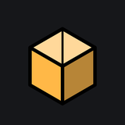
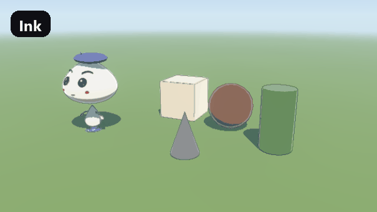
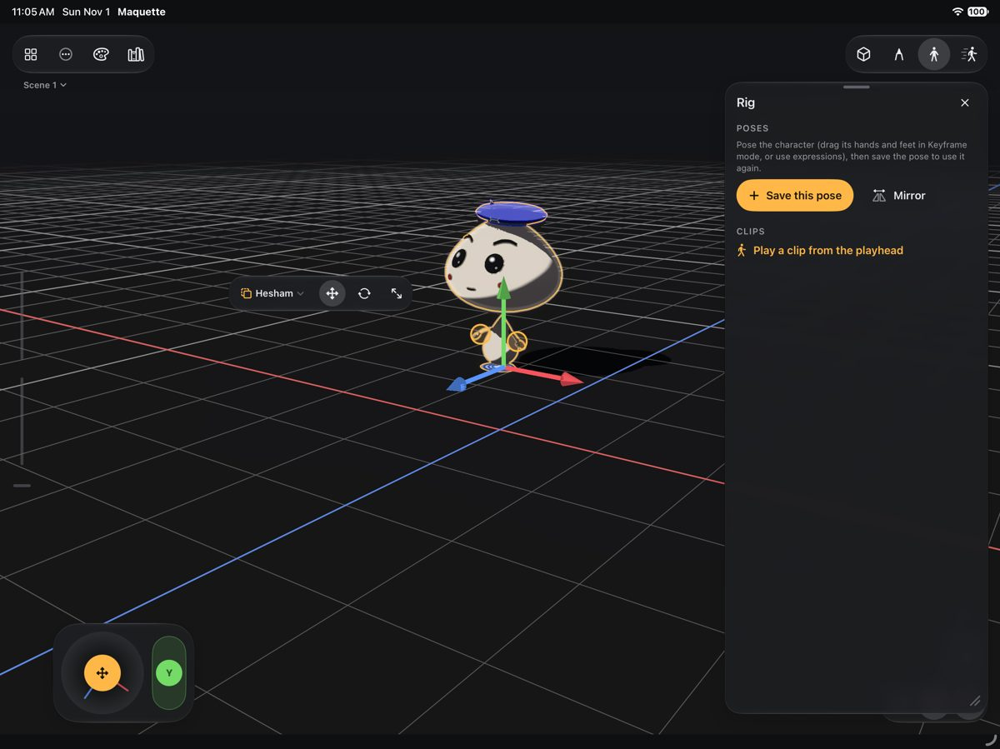
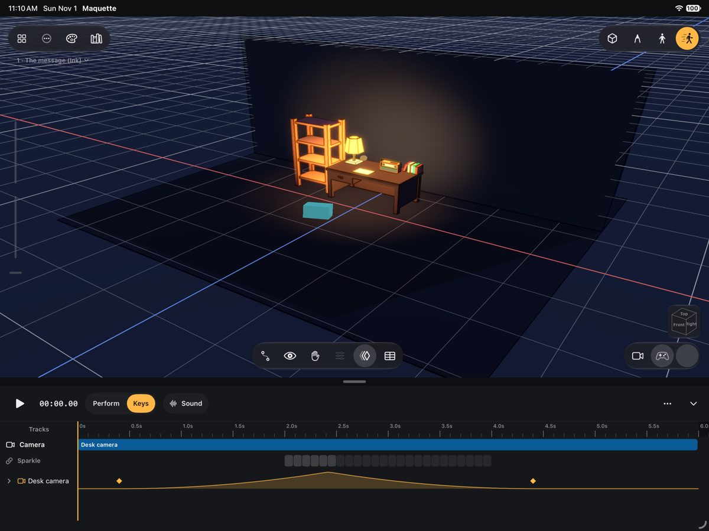
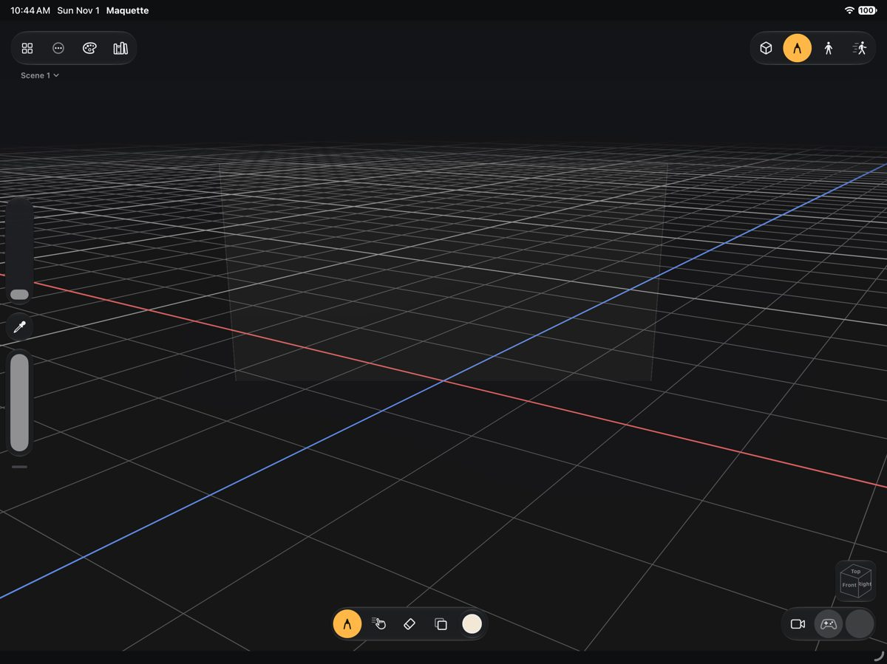
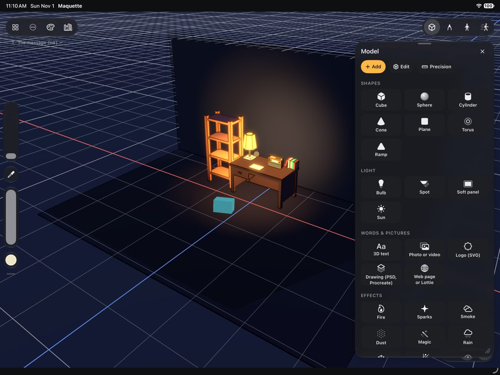
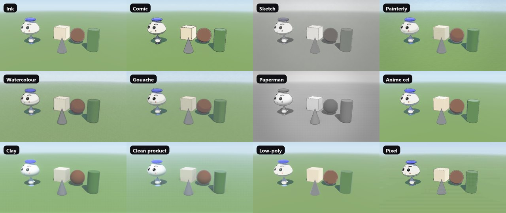
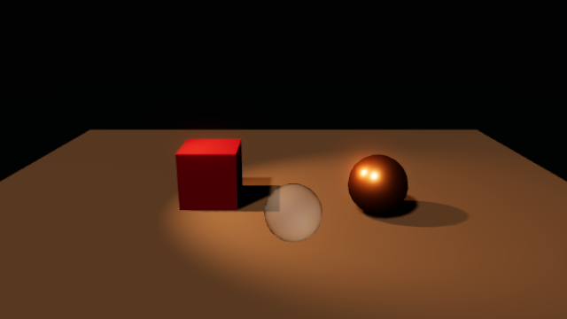

<p align="center">
  
</p>

<h1 align="center">Maquette</h1>

<p align="center">
  <b>3D for people who have never done 3D.</b><br>
  Build a scene on the iPad with your Pencil and your fingers, give it a character or don't, light it, film it,
  and export the video. Free and open source.
</p>

<p align="center">
  <a href="https://github.com/AhmedHeshamEG/maquette/releases/latest"></a>
  <a href="https://github.com/AhmedHeshamEG/maquette/actions/workflows/ci.yml"></a>
  <a href="LICENSE"></a>
  
  
  
</p>

<p align="center">
  <a href="#install">Install</a> ·
  <a href="#what-you-can-make">What you can make</a> ·
  <a href="#looks">Looks</a> ·
  <a href="#direct-it-with-claude">Direct it with Claude</a> ·
  <a href="#build-from-source">Build from source</a> ·
  <a href="#contributing">Contributing</a>
</p>

<p align="center">
  
  <br><sub>One scene, every Look. Each frame is rendered by Maquette's own Metal renderer on CI.</sub>
</p>

---

## Why

3D apps are made for people who already know 3D. Maquette is made the other way round: the Pencil makes things and
your fingers move the view, the way you'd expect on an iPad. You drop in a house kit like Lego, draw a shape and pull
it into a solid, tap a thing to give it eyes and a mouth, record your voice and let it talk, and get a finished
video out, in a Look that doesn't scream "3D app".

- **No degree needed.** One tool at a time, the panels come when called, nothing is greyed out.
- **Made by hand.** No generated art. What's in the frame is what you put there.
- **Yours.** Your projects are folders on your iPad. No account, no server, no tracking, no ads.
- **Open.** Every line of the app is here, under the GPL.

<p align="center">
  
  
</p>
<p align="center">
  
  
</p>

## What you can make

| | |
|---|---|
| 🏠 **A place** | a room, a house, a little world: the house kit, the free CC0 packs, shapes you draw and pull, walls, floors, terrain |
| 🎬 **A film** | cameras with real lenses, rigs (dolly, crane, orbit, handheld), cuts on your spoken words, storyboards and animatics |
| 🧸 **A character** | anything becomes one: name its eyes and mouth, it rigs itself, lip-syncs a typed line, acts out what you film |
| ✏️ **Drawings in 3D** | strokes that land exactly under the Pencil, on surfaces or on sheets, frame-by-frame animation, Procreate and Photoshop brushes |
| 🎨 **Painted models** | layers of colour, roughness, metal, glow and bumps; 24 procedural materials; decals, wear and fur |
| 🪂 **Things that fall** | real physics (Jolt): drop, knock over, cloth, jelly, water, smoke and fire, baked so they play smoothly |
| ✨ **Motion design** | an SVG logo stood up as solids, letters that animate, clones rippling through fields, moving to the music |
| 🧊 **Files for anything** | glTF, USDZ, OBJ, STL, 3MF, FBX, a Blender package, a three.js folder; three.js and glTF scenes come in too |

Video out as MP4, HEVC (HDR), ProRes 4444 with alpha, GIF, PNG frames, render passes, spatial video and 360°.

## Looks

Thirteen ways to draw the same scene, and a Finish that works on any of them: Ink, Comic, Sketch, Painterly,
Watercolour, Gouache, Paperman, Anime cel, Clay, Clean product, **Real**, Low-poly and Pixel. Real is light as a camera
sees it: physically based surfaces, lamps that fall off with distance and cast shadows, glass, a clear coat, a filmic
tone curve.

<p align="center">
  
</p>

<p align="center">
  
  <br><sub>Real: one spot lamp with a soft edge and a real shadow, a glass ball, a metal one reflecting the lamp.</sub>
</p>

## Install

Maquette isn't on the App Store yet. Every green build makes an installable `.ipa`, and you can put it on your own
iPad from any computer, Windows included. No Mac needed.

1. **Get the app**: [Releases](https://github.com/AhmedHeshamEG/maquette/releases/latest) → `Maquette.ipa`.
2. **Install [Sideloadly](https://sideloadly.io)** on a computer and connect the iPad with a cable.
3. Drag `Maquette.ipa` into Sideloadly, pick the iPad, sign in with a **free Apple ID**, press **Start**.
4. On the iPad: **Settings → General → VPN & Device Management** → your Apple ID → **Trust**. If asked, turn on
   **Settings → Privacy & Security → Developer Mode** and restart.
5. Open **Maquette**. The samples are on Home.

A free Apple ID's signature lasts 7 days; after that, connect and press **Start** again. Your projects stay (they live
in *Files → On My iPad → Maquette*).

**Needs** an iPad with iPadOS 26. Apple Pencil is best; a finger draws too.

## Direct it with Claude

Maquette has a bridge for AI assistants, **off until you turn it on**, on your own network only, and only for laptops
you pair. With it, Claude can read your scene, build with the Kit, frame and light shots, animate on your spoken words,
bring in a finished three.js or glTF scene as built, and look at what it made before it asks you. Every change arrives
on the iPad as a proposal you apply or not, one undo step each.

```powershell
pip install "git+https://github.com/AhmedHeshamEG/maquette#subdirectory=Tools/lowey"
# On the iPad: Settings ▸ Assistant ▸ turn the bridge on ▸ Pair a laptop (shows a one-time code)
hmm-bridge pair 123456
claude mcp add lowey -- hmm-bridge mcp
```

Any AI can also write a [Scene Script](schemas/scene-script.v3.schema.json) and paste it with ⌥⌘V. The Claude skill
that teaches the bridge is in [`skills/lowey`](skills/lowey); the tools are in [`Tools/lowey`](Tools/lowey/README.md).

## Build from source

Nothing needs a Mac: GitHub Actions builds, tests and packages everything. The Xcode project is generated from
[`project.yml`](project.yml) with XcodeGen.

```
Packages/LoweyCore      pure Swift: the model, commands, timeline, motion, geometry, modelling, characters, physics,
                        import and export, Scene Scripts (runs on Linux)
Packages/LoweyEngine    the Metal renderer, the stage, video and model export
Packages/LoweyFeatures  the SwiftUI app, one folder per feature
Packages/HmmKit         hmm-kit (a git subtree): design system, commands, documents, the bridge, media
Packages/Manifold, Jolt, XAtlas, InstantMeshes   vendored libraries, each behind a small C face
App/                    the app target and the Kit (CC0 models)
AppUITests/             UI tests, the layout walk, App Store screenshots
Tools/                  hmm-bridge (the laptop CLI and MCP server) and CI helpers
skills/lowey            the Claude skill and its evals
```

- Core tests run anywhere Swift runs, Docker on Windows included:
  `docker run --rm -v "$PWD:/work" -w /work/Packages/LoweyCore swift:6.1 swift test`
- [CI](.github/workflows/ci.yml): SwiftLint `--strict`, SwiftFormat, the Core tests on Linux, the laptop tools, the
  renderer's golden images for every Look, the app's tests on an iPad simulator, and UI tests in four shards.
- [Release](.github/workflows/release.yml): from commits CI passed only; tags publish a GitHub Release with the `.ipa`.
- Where every control lives: [docs/LAYOUT.md](docs/LAYOUT.md). Why things are the way they are:
  [docs/DECISIONS.md](docs/DECISIONS.md). What changed: [CHANGELOG.md](CHANGELOG.md).

## Contributing

Bug reports and ideas are welcome in [Issues](https://github.com/AhmedHeshamEG/maquette/issues). Pull requests are
welcome too; read [CONTRIBUTING.md](CONTRIBUTING.md) first (it explains the small contributor agreement).

## Licence

Maquette is free software under the [GNU General Public License v3.0](LICENSE): you may use, study, change and share
it, and anything built from it must stay free and open under the same licence. Third-party software and its licences:
[LICENSES.md](LICENSES.md).

The name **Maquette**, **studio h.** and the app's icon are not covered by the licence: see
[TRADEMARKS.md](TRADEMARKS.md).

<p align="center"><sub>Made by Hesham · studio h.</sub></p>
